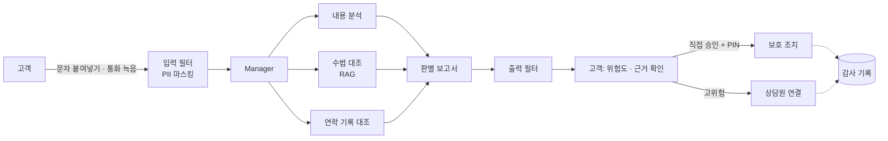

# 주제 제안 ①: 사칭 판별 비서 — 유출 이후 고객을 지키는 은행

> 상태: 팀 회의용 제안 (미확정)
>
> 지금 주제(말로 하는 은행)를 대체하는 새 주제 후보다. 함께 올라온 제안 ③ 침해사고 대응 코파일럿(PR #143), 기존 주제에 보안 축을 더한 PR #141과 비교해 하나를 고른다. 채택하면 MVP·PRD·ERD·README를 이 문서 기준으로 다시 쓴다. 수치·일정은 회의에서 정한다.

## 1. 한 줄

**"방금 은행이라고 전화 왔는데, 진짜예요?" — 고객이 묻고, AI가 근거를 대고, 보호 조치는 고객이 직접 승인한다.**

## 2. 왜 이 주제인가

- 2026년 9~10월 은행권 해킹으로 7개 금융사에서 약 6만 8천 건이 유출됐다. 유출 항목에는 연소득·대출한도 같은 금융 정보가 있다.
- 이 정보를 가진 범인은 "은행 직원·대출상담사"를 그럴듯하게 사칭할 수 있다. 금융당국도 2차 피해를 우려해 소비자경보 '주의'를 냈다.
- 그런데 현행 비대면 금융사고 책임분담제도는 **피해자가 직접 송금한 경우 보상 대상에서 빠진다.** 송금하기 전에 막는 것 말고는 방어 수단이 없다.
- 멘토링(10/8) 조언과도 맞다: "LLM으로 시스템을 잘 다루는 주제", "돈이 오가는 취약점", "회사에 적용할 수 있겠다는 인상".

## 3. 무엇을 만드나

| 구성          | 역할                                                                                        |
| ------------- | ------------------------------------------------------------------------------------------- |
| 판별 요청     | 고객이 받은 문자를 붙여넣거나 통화를 녹음해 올린다. 녹음은 STT로 텍스트로 바꾼다            |
| 판별 에이전트 | 위험도(낮음·주의·높음)와 근거를 담은 보고서를 만든다. "안전하다"고 단정하지 않는다          |
| 보호 조치     | 지연이체, 비대면 대출 차단, 신규 수취인 송금 제한. AI는 제안만 하고 고객이 PIN으로 승인한다 |
| 상담원 콘솔   | 고위험 건 확인, 고객 연락, 판별 결과 정정. 지금 만드는 관리자 화면을 확장한다               |

## 4. 에이전트 구성

| Worker         | 하는 일                                                                                 | 근거·도구                                         |
| -------------- | --------------------------------------------------------------------------------------- | ------------------------------------------------- |
| 내용 분석      | 발신자가 주장하는 기관, 요구하는 행동(송금·앱 설치·개인정보 요구), 긴급성 표현을 뽑는다 | 대화 텍스트                                       |
| 수법 대조      | 알려진 사칭 수법과 비슷한지 찾는다                                                      | RAG: 금융감독원·경찰청 공개 사례, 은행 공지       |
| 연락 기록 대조 | 그 시각에 은행이 실제로 그 고객에게 연락했는지 확인한다                                 | 은행 내부 연락 이력 조회 (읽기 전용, 본인 기록만) |
| 판별 보고서    | 위험도, 근거 문장, 권하는 보호 조치를 정리한다                                          | 위 결과                                           |

강의(Quant-X)에서 그대로 가져오는 것: Manager-Worker, RAG + 신뢰하지 않는 문서 격리, Tool Gateway 권한 검사, Input/Output Filter, 사람 승인, 감사 기록, Kill Switch.

| 강의에서 바꾸는 5가지 | Quant-X                         | 이 제안                                              |
| --------------------- | ------------------------------- | ---------------------------------------------------- |
| Worker 역할           | 리서치 · 시세 · 리스크 · 보고서 | 내용 분석 · 수법 대조 · 연락 기록 대조 · 판별 보고서 |
| RAG 데이터            | 사내 리포트 · 공시              | 공개 사칭 사례 · 은행 공지                           |
| PII 패턴              | 주민번호 · 계좌번호             | 같은 패턴 + 대화 속 PIN·인증번호                     |
| 결재자                | 시니어 매니저                   | 고객 본인(보호 조치), 상담원(고위험 건)              |
| 차단 표현             | "수익 보장"                     | "확실히 안전합니다", "보내셔도 됩니다" 같은 단정     |

## 5. 안전장치

- **판정이 아니라 근거:** 출력은 위험도와 근거다. "안전" 단정 표현은 출력 필터가 막는다. 오탐보다 미탐이 위험하므로 애매하면 '주의'로 둔다.
- **AI에는 실행 기능이 없다:** 보호 조치는 고객이 확인하고 PIN을 입력해야 실행된다. AI가 송금하거나 조치를 대신 켜지 않는다.
- **본인 기록만:** 연락 이력 조회는 로그인한 고객 본인 것만 서버가 확인해 돌려준다.
- **민감정보 최소화:** 대화 속 주민번호·카드번호·인증번호는 AI에 넘기기 전에 가린다. 녹음 원본은 STT 후 저장하지 않는 안을 제안한다.
- **기록:** 판별 요청, 보호 조치, 상담원 처리는 감사 기록에 남는다.

## 6. 지금 작업과의 관계

| 지금 작업                            | 이 제안에서                          |
| ------------------------------------ | ------------------------------------ |
| 은행 코어(계좌·거래·송금, #103~#112) | 그대로 필요. 보호 조치가 걸리는 대상 |
| 간편 비밀번호(#109·#114)             | 보호 조치 승인에 그대로 사용         |
| STT(#92·#139)                        | 통화 녹음 판별 입력으로 재사용       |
| 챗봇 대화 상태(#81~#83)              | 판별 대화로 바꿔 재사용              |
| 관리자 이상 거래 화면(#137)          | 상담원 콘솔(고위험 판별 건)로 확장   |
| 음성·텍스트 송금(#116)               | 우선순위를 낮춘다                    |

## 7. 범위 제안

| 우선 | 내용                                                                                              |
| ---- | ------------------------------------------------------------------------------------------------- |
| P0   | 문자 판별(텍스트 입력), 수법 대조 RAG, 판별 보고서, 보호 조치 1개(지연이체) + PIN 승인, 감사 기록 |
| P1   | 통화 녹음 판별(STT), 연락 기록 대조, 상담원 콘솔, 보호 조치 추가                                  |
| P2   | 판별 정확도 측정 리포트(시나리오별 맞힘/전체), Kill Switch                                        |

## 8. 시연

1. 시연용 고객에게 "OO은행 대출상담팀입니다. 기존 대출 상환용 계좌로 이체하시면 금리를 낮춰 드립니다" 같은 가상 문자가 온다.
2. 고객이 붙여넣으면 위험도 '높음'과 근거(은행 연락 기록 없음, 알려진 대환대출 사칭 수법, 송금 요구)가 나온다.
3. 고객이 지연이체를 승인하고, 이후 송금이 지연되는 것을 보여준다.
4. 상담원 콘솔에 건이 올라오고, 감사 기록으로 전 과정을 확인한다.
5. 끝으로 시나리오 묶음의 판별 결과를 숫자로 보여준다. 놓친 사례도 숨기지 않는다.

## 9. 회의에서 정할 것

- [ ] 이 안을 채택할지 (제안 ③ PR #143, PR #141과 비교)
- [ ] P0 범위와 담당자
- [ ] 보호 조치의 종류와 지연이체 시간
- [ ] 판별 정확도를 무엇으로 잴지(시나리오 개수, 공개 사례 출처)
- [ ] 녹음 원본 저장 여부와 보존 기간

## 10. 출처

- [2026년 금융권 AI 해킹 및 정보유출 사태 — IT 위키](https://itwiki.kr/w/2026%EB%85%84_%EA%B8%88%EC%9C%B5%EA%B6%8C_AI_%ED%95%B4%ED%82%B9_%EB%B0%8F_%EC%A0%95%EB%B3%B4%EC%9C%A0%EC%B6%9C_%EC%82%AC%ED%83%9C)
- [금융권 해킹 사고로 보이스피싱 당하면…'전액 보상' 받을 수 있을까 — 파이낸셜뉴스](https://www.fnnews.com/news/202610070601565666)
- [금융 AI 에이전트 설계 및 구현 — 강의 자료](https://codro.notion.site/AI-35df7842d36a80869108dba773a0dca6)
- [2026-10-08 멘토링 회의록](./meetings/2026-10-08-mentor.md)
