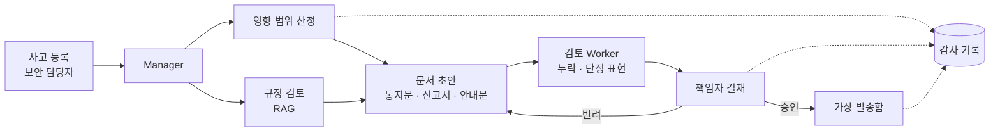

# 주제 제안 ③: 침해사고 대응 코파일럿 — 유출이 터진 뒤 72시간을 돕는 AI

> 상태: 팀 회의용 제안 (미확정)
>
> 지금 주제(말로 하는 은행)를 대체하는 새 주제 후보다. 함께 올라온 제안 ① 사칭 판별 비서(PR #142), 기존 주제에 보안 축을 더한 PR #141과 비교해 하나를 고른다. 채택하면 MVP·PRD·ERD·README를 이 문서 기준으로 다시 쓴다. 수치·일정은 회의에서 정한다.

## 1. 한 줄

**사고가 나면 해야 할 일 — 누가 무엇을 잃었는지, 고객에게 뭐라고 알릴지, 당국에 무엇을 신고할지 — 을 AI가 초안으로 만들고, 책임자가 결재해야 나간다.**

## 2. 왜 이 주제인가

- 2026년 9~10월 은행권 해킹으로 7개 금융사에서 약 6만 8천 건이 유출됐다. 은행마다 피해 규모와 항목을 파악해 공식화하기까지 며칠이 걸렸고, 공개된 피해 숫자도 여러 번 바뀌었다.
- 유출이 확인되면 정해진 기한 안에 고객 통지와 당국 신고를 해야 한다(개인정보보호법상 72시간 이내 — 회의 전 원문 확인 필요). 영향 범위 산정, 통지문, 신고서, 2차 피해 안내를 동시에 준비해야 한다.
- 이 일은 "정확한 숫자 + 규정에 맞는 문서 + 책임자 결재"가 핵심이라, 강의(Quant-X)의 "리서치 → 보고서 → 사람 결재 → 감사" 구조와 그대로 맞는다.
- 멘토링(10/8)의 "장애 대응을 했다고 말할 수 있는 것", "회사에 적용할 수 있겠다는 인상"과도 맞다.

## 3. 무엇을 만드나

| 구성           | 역할                                                                                            |
| -------------- | ----------------------------------------------------------------------------------------------- |
| 사고 등록      | 보안 담당자가 사고 시각, 의심 시스템, 기간을 등록한다. 시연은 미리 만든 가상 사고 데이터로 한다 |
| 영향 범위 산정 | 감사 기록에서 해당 기간·시스템의 조회 기록을 모아 영향받은 고객과 정보 항목을 집계한다          |
| 문서 초안      | 고객 통지문, 당국 신고서, 고객별 2차 피해 주의 안내를 만든다                                    |
| 결재·발송      | 책임자가 결재해야 가상 발송함으로 나간다. 기한까지 남은 시간을 화면에 보여준다                  |

## 4. 에이전트 구성

| Worker         | 하는 일                                                                                              | 근거·도구                                     |
| -------------- | ---------------------------------------------------------------------------------------------------- | --------------------------------------------- |
| 영향 범위 산정 | 영향 고객 수, 항목별 건수, 고객 목록을 만든다. **숫자는 SQL·규칙으로 계산하고 AI는 계산하지 않는다** | 감사 기록 조회 (읽기 전용)                    |
| 규정 검토      | 통지·신고에 꼭 들어가야 할 항목과 기한을 찾는다                                                      | RAG: 개인정보보호법·신용정보법, 금융당국 안내 |
| 문서 초안      | 통지문·신고서·안내문을 쓴다. 숫자는 영향 범위 결과만 인용한다                                        | 위 결과                                       |
| 검토           | 필수 항목 누락, 숫자 불일치, "피해 없음"처럼 확인 안 된 단정을 찾아 반려한다                         | 규칙 검사                                     |

| 강의에서 바꾸는 5가지 | Quant-X                         | 이 제안                                                  |
| --------------------- | ------------------------------- | -------------------------------------------------------- |
| Worker 역할           | 리서치 · 시세 · 리스크 · 보고서 | 영향 범위 · 규정 검토 · 문서 초안 · 검토                 |
| RAG 데이터            | 사내 리포트 · 공시              | 개인정보·신용정보 관련 법령, 당국 안내, 사내 대응 매뉴얼 |
| PII 패턴              | 주민번호 · 계좌번호             | 같은 패턴. 고객 목록은 AI에 원문으로 넘기지 않는다       |
| 결재자                | 시니어 매니저                   | 개인정보보호책임자, 보안 책임자                          |
| 차단 표현             | "수익 보장"                     | "추가 피해 없음", "안전합니다" 같은 확인 안 된 단정      |

## 5. 안전장치

- **AI에는 발송 기능이 없다:** 통지·신고는 책임자 결재 후 서버가 보낸다.
- **숫자는 코드가 계산한다:** 영향 고객 수·항목 수는 쿼리 결과이고, 문서의 숫자가 그 결과와 다르면 검토 단계에서 반려한다.
- **고객 정보 최소화:** AI는 집계와 마스킹된 표본만 본다. 고객별 안내문은 템플릿에 서버가 값을 채운다.
- **기록:** 사고 등록, 산정 결과, 초안 버전, 결재, 발송이 모두 감사 기록에 남는다.

## 6. 지금 작업과의 관계

| 지금 작업                              | 이 제안에서                                     |
| -------------------------------------- | ----------------------------------------------- |
| 은행 코어(계좌·거래, #103~#112)        | 영향 범위 산정의 원본 데이터. 규모를 줄여 유지  |
| 관리자 화면(#119~#138)                 | 사고 대응 콘솔로 확장 (사고 목록·결재함·발송함) |
| 감사 기록(PR #141의 SEC-12)            | 이 제안의 핵심 입력. 우선순위가 가장 높아진다   |
| 챗봇·STT·음성 송금(#81~#83, #92, #116) | 우선순위를 낮추거나 뺀다                        |

## 7. 범위 제안

| 우선 | 내용                                                                                    |
| ---- | --------------------------------------------------------------------------------------- |
| P0   | 감사 기록, 가상 사고 데이터, 영향 범위 산정, 고객 통지문 초안, 책임자 결재, 가상 발송함 |
| P1   | 규정 RAG, 당국 신고서 초안, 검토 Worker 반려 루프, 기한 표시                            |
| P2   | 고객별 2차 피해 안내, 사고 타임라인 화면, Kill Switch                                   |

## 8. 시연

1. 보안 담당자가 "업무지원 시스템 비정상 조회 의심" 사고를 등록한다(가상 데이터).
2. 영향 범위가 집계된다: 영향 고객 수, 항목별 건수.
3. 통지문·신고서 초안이 근거와 함께 나오고, 검토 Worker가 누락 항목을 잡아 한 번 반려한다.
4. 책임자가 결재하면 가상 발송함으로 나가고, 기한 대비 소요 시간이 표시된다.
5. 감사 기록으로 "누가 언제 무엇을 승인했는지"를 확인한다.

## 9. 회의에서 정할 것

- [ ] 이 안을 채택할지 (제안 ① PR #142, PR #141과 비교)
- [ ] 고객 화면을 얼마나 남길지 (프론트엔드 역할 배분)
- [ ] P0 범위와 담당자
- [ ] 통지·신고 기한과 필수 항목을 어느 법령·안내 기준으로 잡을지
- [ ] 가상 사고 데이터를 어떻게 만들지

## 10. 출처

- [2026년 금융권 AI 해킹 및 정보유출 사태 — IT 위키](https://itwiki.kr/w/2026%EB%85%84_%EA%B8%88%EC%9C%B5%EA%B6%8C_AI_%ED%95%B4%ED%82%B9_%EB%B0%8F_%EC%A0%95%EB%B3%B4%EC%9C%A0%EC%B6%9C_%EC%82%AC%ED%83%9C)
- [은행은 정보유출, 증권사는 전산장애···금융권 IT 사고 잇따라 — 다음](https://v.daum.net/v/20261003095253976)
- [금융 AI 에이전트 설계 및 구현 — 강의 자료](https://codro.notion.site/AI-35df7842d36a80869108dba773a0dca6)
- [2026-10-08 멘토링 회의록](./meetings/2026-10-08-mentor.md)
